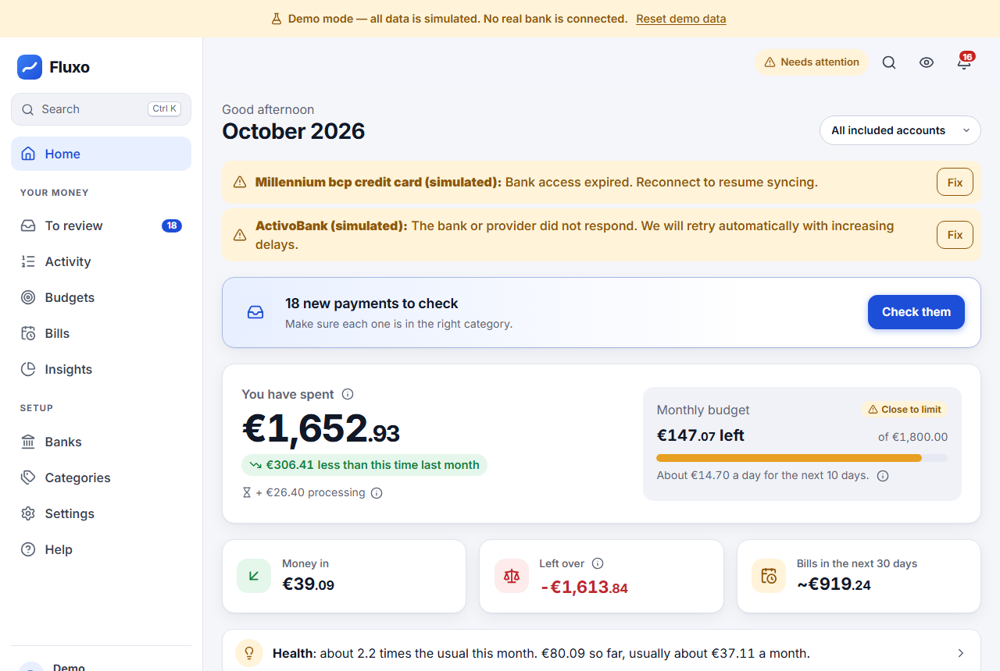
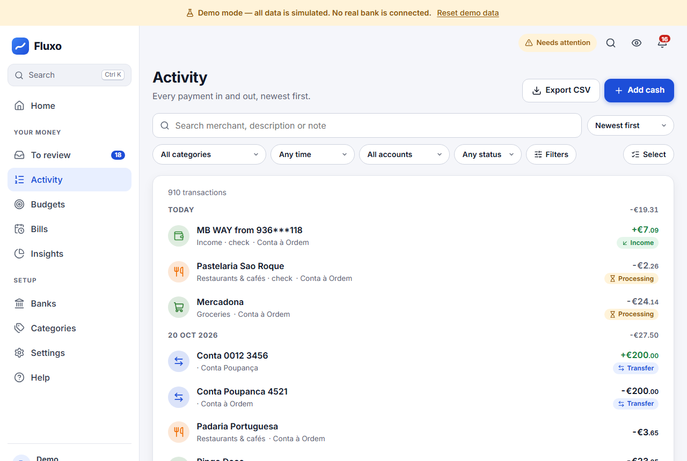
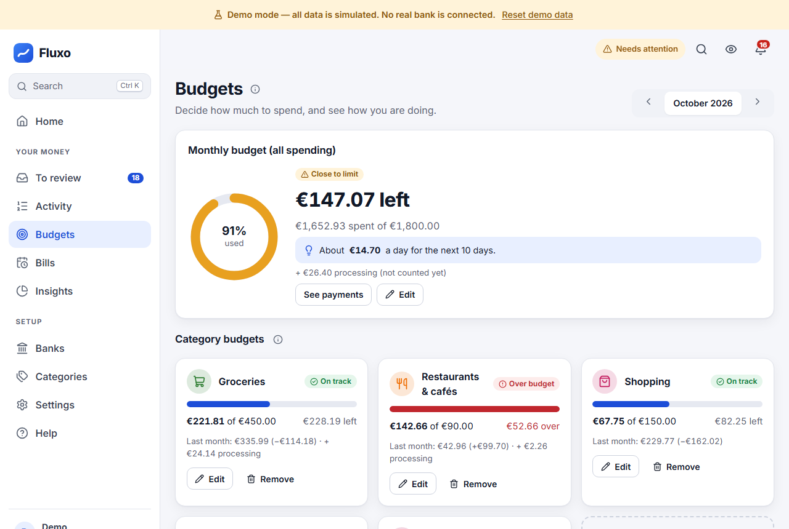
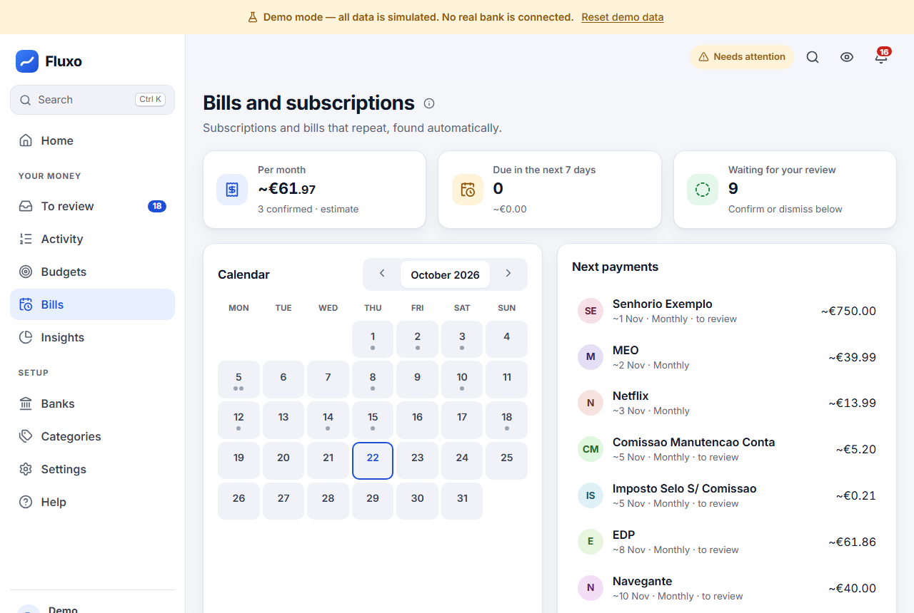
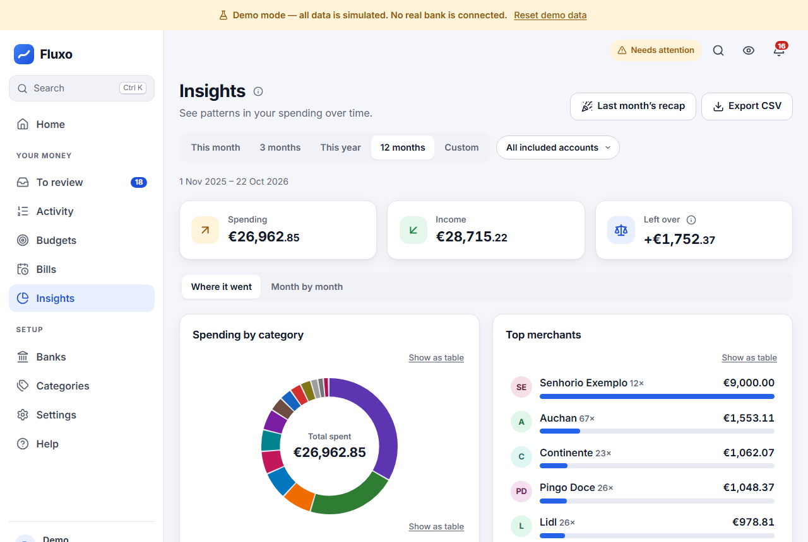
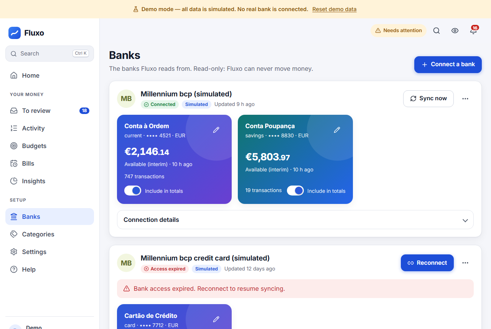
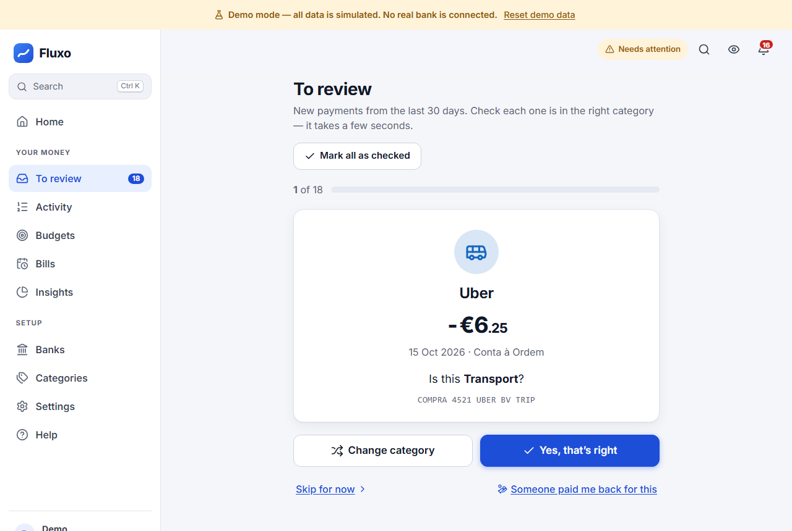
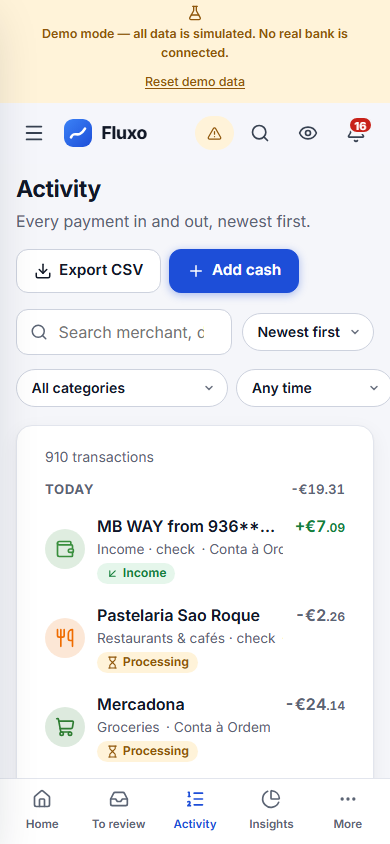

# Fluxo — automatic expense tracker

> Connect your bank account, let transactions sync automatically, and understand where your money goes.

Fluxo is a self-hosted, open-source expense tracker. It imports your transactions through a regulated
open-banking provider (read-only), categorizes them automatically, and shows spending, budgets,
recurring payments and reports — without manual data entry as the main workflow.

Built first for someone in Portugal using **Millennium bcp**, with English UI, EUR and Europe/Lisbon
defaults (all configurable).



| Activity | Budgets | Bills |
|---|---|---|
|  |  |  |
| **Insights** | **Banks** | **To review** |
|  |  |  |
| **Phone** | | |
|  | | |

All screenshots use synthetic demo data.

## Features

- **Automatic sync** (server-side, background) via [Enable Banking](https://enablebanking.com) — read-only account information; no payments, no scraping, no bank passwords in Fluxo.
- **Reliable imports**: full initial pagination, overlapping incremental windows, idempotent writes, pending→posted reconciliation, identical purchases kept separate, never deletes posted history. See [docs/SYNC.md](docs/SYNC.md).
- **Friendly, guided interface**: a first-run welcome, an optional guided tour, plain-language labels with ⓘ explanations, category icons, illustrations, Ctrl+K quick search, and a phone layout with a bottom tab bar.
- **Home**: what you spent this month (compared with last month), budget left per day, money in, bills coming up, and an interactive “where it went” chart you can click into.
- **To review**: new payments wait in a short queue; confirm each category with one tap (or swipe on a phone), change it, or mark them all as checked.
- **Paid back**: link a friend’s MB WAY or transfer to the dinner it paid for, so only your share counts as spending.
- **Gentle hints and a monthly recap**: one-line notes such as “Spotify went up from €7.99 to €8.99” or a category well above its usual month, and a five-card look back at last month. Computed locally; nothing is sent to AI services.
- **Easy to read**: text size setting (Normal / Large / Extra large), balance-over-time chart, details open as a bottom sheet on phones, and Fluxo can be installed as an app (its own window and icon).
- **Activity**: grouped by day (day headers stay visible while you scroll); search, quick filter chips (account, dates, category, type, status, amount), sorting, detail view showing bank facts vs. your own labels, notes, bulk edits, exclusion from reports, undo.
- **Categorization without AI services**: your corrections → your rules → known merchants / card codes → description keywords → Uncategorized. Every category shows *why* and *how confident*. Rule preview before applying to history.
- **Budgets**: monthly total + category limits with progress rings, a step-by-step setup that suggests amounts from your last 3 months, 80 %/100 % alerts (configurable), previous-month comparison.
- **Bills and subscriptions**: a calendar of expected payments; weekly/monthly/quarterly/yearly detection, subscriptions vs. bills, variable bills, monthly equivalents — always labelled as estimates.
- **Insights & exports**: category, monthly trend, income vs. spending, budget vs. actual, merchants, commitments; filtered CSV (formula-injection safe) and full JSON export.
- **Privacy & security**: hashed server-side sessions, optional TOTP 2-step verification, rate limiting, CSRF defences, CSP, encrypted provider sessions, hide-amounts toggle, data export and deletion. No analytics, no trackers.
- **Demo mode** with realistic Portuguese synthetic data — try everything without a bank.
- Accessible (keyboard, screen readers, contrast, reduced motion, chart tables), responsive, light/dark.

## Quick start (demo, 2 minutes)

Requirements: **Node.js 24+** (uses the built-in `node:sqlite` and native TypeScript support). No database server, no Docker needed.

```bash
npm ci
```

```bash
npm run build
```

```bash
npm start
```

Open <http://localhost:3000> and click **Try the demo**. Demo mode is the default when no configuration exists; it never contacts a bank.

For development with hot reload run `npm run dev:api` and `npm run dev:web` in two terminals, then open <http://localhost:5173>.

## Using it with your own bank (live mode)

1. `cp .env.example .env` and set `APP_MODE=live`.
2. `npm run gen-key` and paste the output into `DATA_ENCRYPTION_KEY`. **Back this key up separately.**
3. Create an Enable Banking application and link your own accounts (free “restricted mode” for personal use) — step by step in [docs/PROVIDERS.md](docs/PROVIDERS.md). Put the app id and private-key path in `.env`.
4. `npm run build && npm start`, open the app, create your account (the first account on a server; further sign-ups are closed unless `ALLOW_REGISTRATION=true`).
5. Accounts → **Connect a bank** → choose Millennium BCP. You sign in at your bank; Fluxo only receives read-only access.

Hosting on a server (HTTPS, reverse proxy, scheduler, backups): [docs/DEPLOYMENT.md](docs/DEPLOYMENT.md).

## What Fluxo can and cannot see

- Only transactions your bank exposes through open banking, within the connection’s history window and permissions (commonly 90 days after the first hour; often more on the first sync).
- Pending card payments may appear late, change amount or vanish; they are tracked separately.
- Cash spent after an ATM withdrawal is invisible; you can add manual cash entries (clearly marked).
- No receipt line items. MB WAY only as recorded on the connected account. Other cards/wallets need their own connection.
- Automatic syncing only happens while the server (or a scheduled `npm run sync`) runs. Banks typically allow ~4 background refreshes per day; consent lasts up to ~180 days and must then be renewed.

## Status

| Area | Status |
|---|---|
| Demo mode, all screens, calculations, sync engine | Verified with synthetic data (unit, integration, end-to-end tests) |
| Enable Banking adapter | Implemented against the documented API and tested with documented response shapes. **Not yet verified in the provider sandbox or with a real account** (needs credentials) |
| Live Millennium bcp connectivity | Awaiting an authorized Enable Banking application |

## Documentation

- [Architecture & data flow](docs/ARCHITECTURE.md) · [Financial rules](docs/FINANCIAL_RULES.md) · [Sync](docs/SYNC.md)
- [Provider setup](docs/PROVIDERS.md) · [Deployment](docs/DEPLOYMENT.md) · [Backup & restore](docs/BACKUP.md)
- [Privacy & data lifecycle](docs/PRIVACY.md) · [Terms of use](docs/TERMS.md) · [Data export format](docs/DATA_EXPORT.md) · [Troubleshooting](docs/TROUBLESHOOTING.md)
- [Security policy](SECURITY.md) · [Contributing](CONTRIBUTING.md) · [Changelog](CHANGELOG.md) · [Release checklist](docs/RELEASE_CHECKLIST.md) · [Dependencies](docs/DEPENDENCIES.md)

## Commands

| Command | What it does |
|---|---|
| `npm start` | Run the server (serves the built UI) |
| `npm run build` | Build the web UI |
| `npm run check` | Type-check, lint, unit/integration tests, build |
| `npm run test:e2e` | Browser tests (desktop + mobile, accessibility scan) — run `npm run build` first |
| `npm run sync` | One-shot background sync (for cron/systemd) |
| `npm run backup` / `npm run restore -- <file>` | Database backup / restore |
| `npm run reset-password -- <email>` | Account recovery for self-hosted installs |
| `npm run gen-key` | Generate `DATA_ENCRYPTION_KEY` |
| `npm run scan:secrets` | Scan publishable files for secrets/private data |

## License

[MIT](LICENSE). Fluxo is not affiliated with Millennium bcp, Enable Banking or any bank. It is not financial advice.
